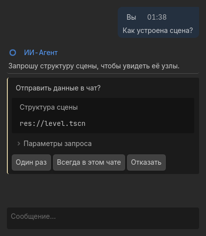
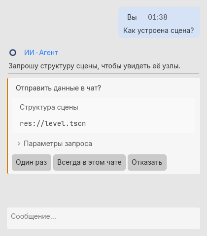

# Док Godot Agent

«Мастерская проекта»: на главной — схема узлов, сохранённые чаты и два входа в новый диалог. В переписке вопрос помещается в компактную плашку, а ответ занимает всю доступную ширину. Ниже — главная при 250 px и пример запроса чтения при 420 px, отрисованные в Godot 4.6.3 на тестовом диалоге.

В карточке чтения сразу показаны операция и цель. «Параметры запроса» раскрывает точные аргументы до выбора разрешения.

| Тёмная тема | Светлая тема |
| --- | --- |
|  |  |
|  |  |
