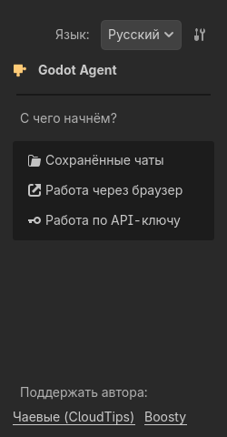
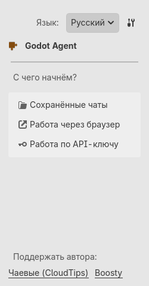

# Док Godot Agent

«Мастерская проекта»: на главной — схема узлов, сохранённые чаты и два входа в новый диалог. У вопроса пользователя есть подпись, время и кнопка копирования; многострочный текст переносится по ширине дока. Ниже — главная при 250 px и тестовый диалог при 420 px, отрисованные в Godot 4.6.3.

В примере агент проверяет подключение сигнала `collected`: заголовок выделяет тему, жирное «Важно» — вывод, курсив — следующий шаг. Строка кода набрана моноширинным шрифтом на фоне из текущей темы. «Запрос инструмента» раскрывает JSON внутри реплики, а разрешение на поиск даётся отдельно, в следующей карточке.

| Тёмная тема | Светлая тема |
| --- | --- |
|  |  |
|  |  |
